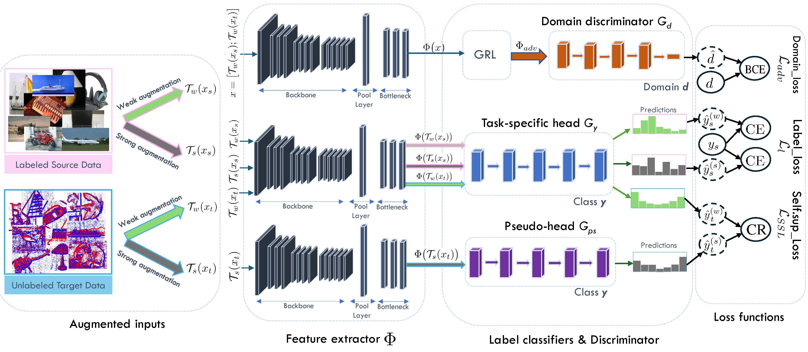

# ADA-SSR

Official implementation of **Adversarial Domain Adaptation and Self-Supervised Refinement for Event Sensory Data**.

## Overview

ADA-SSR combines adversarial domain adaptation with self-supervised refinement to transfer knowledge from labeled RGB images to unlabeled event data.

<p align="center">
  
</p>

## Installation

```bash
git clone https://github.com/cv-mines/ADA-SSR.git
cd ADA-SSR
conda create --name ada-ssr python=3.10
conda activate ada-ssr
pip install -r requirements.txt
```

## Data Preparation

Organize each dataset using the following structure:

```text
root/
├── source_train/
├── source_test/
├── target_train/
├── target_test/
└── image_list/
    ├── source_train.txt
    ├── source_test.txt
    ├── target_train.txt
    └── target_test.txt
```

Each line in a list file contains an image path relative to the dataset root and its class label:

```text
source_train/example.jpg 0
```

Use the same class-label mapping in both domains.

## Training

```bash
python3 main_ada_ssr.py data/caltech101DVS -a resnet50 --epochs 50 --seed 1 --log logs/Caltech101DVS/ada_ssr
```

## Citation

```bibtex
@article{fradi2026adversarial,
  title = {Adversarial Domain Adaptation and Self-Supervised Refinement for Event Sensory Data},
  author = {Fradi, Hajer and Papadakis, Panagiotis},
  journal = {Journal of Visual Communication and Image Representation},
  volume = {121},
  pages = {104987},
  year = {2026},
  doi = {10.1016/j.jvcir.2026.104987}
}
```

## Acknowledgments

Parts of the code are adapted from the [Transfer Learning Library](https://github.com/thuml/Transfer-Learning-Library). The bundled third-party license text is included in `LICENSE_TLIB.txt`.
